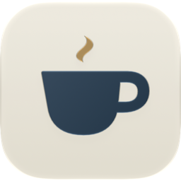
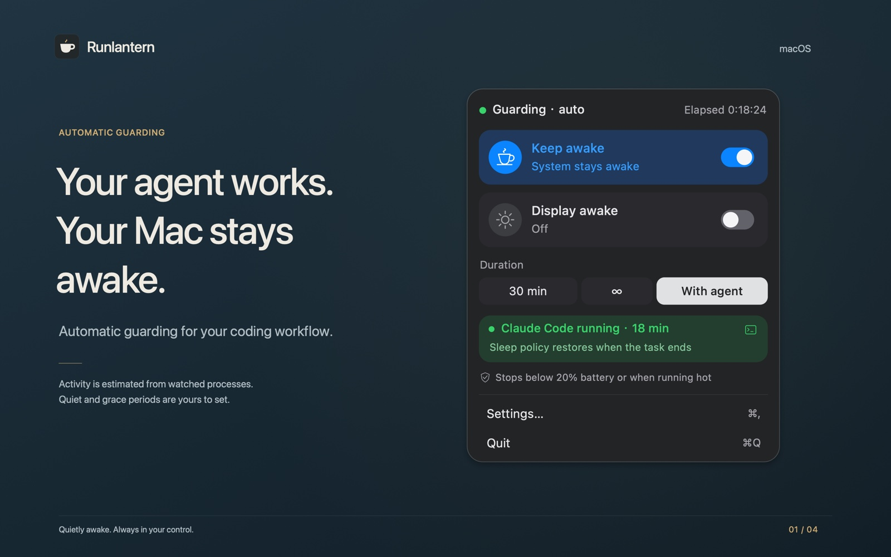
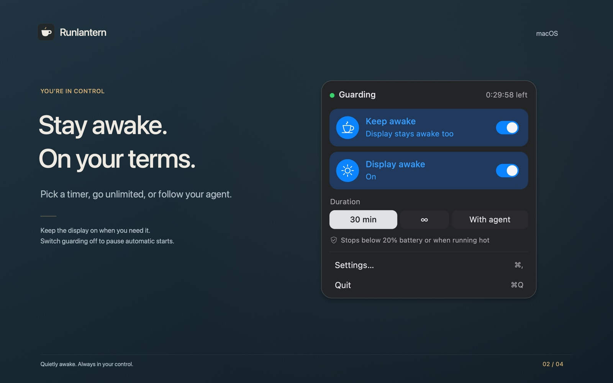
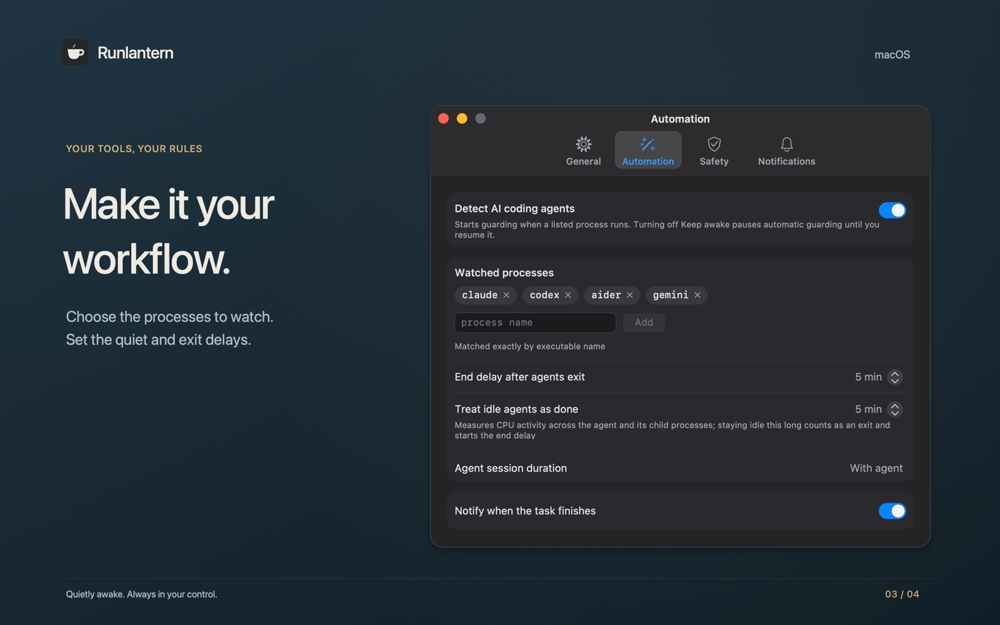
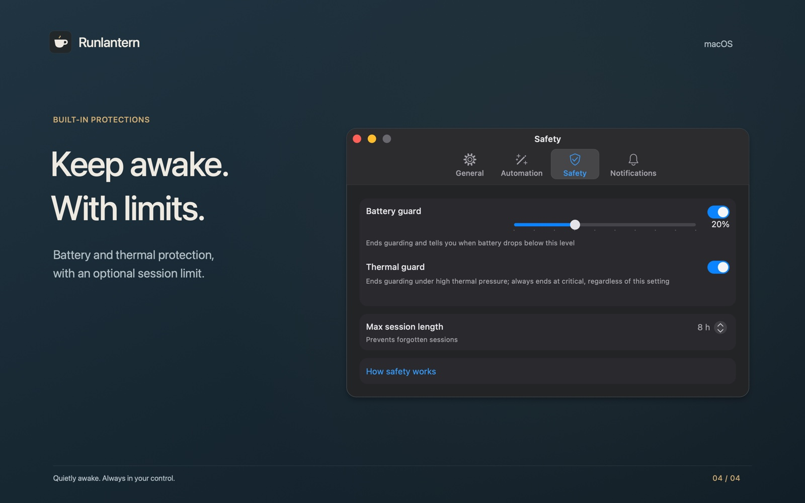

  <picture>
    <source media="(prefers-color-scheme: dark)" srcset="assets/icon-dark.png">
    
  </picture>

<h1 align="center">Runlantern</h1>

  <strong>Keep your Mac awake while AI coding agents work.</strong> 
  A free menu bar app that holds off idle sleep while Claude Code, Codex, Aider or Gemini CLI are busy, then steps aside.

  

  
  
  
  

  <a href="README.zh-Hans.md">简体中文</a> ·
  <a href="https://runlantern.pages.dev/en/">Website</a> ·
  <a href="https://runlantern.pages.dev/en/privacy/">Privacy</a>

  

## What it does

- **Guards while your agent works.** Choose *With agent* and Runlantern starts when a watched command-line tool gets busy. It ends after the tool exits or goes quiet, with a grace period you set.
- **Or on your own terms.** A custom timer, an unlimited session, and an optional *Display awake*.
- **Off means off.** Switching guarding off pauses every automatic start, even after a restart, until you turn it back on.
- **Safety limits.** A battery threshold, thermal protection and a maximum session length. Critical thermal pressure always ends a session.
- **Honest status.** If macOS doesn't confirm a power request or its release, the panel says so instead of showing a false state.
- **Stays on your Mac.** No account, no networking, no analytics. The App Store privacy label is *Data Not Collected*.

<strong>More images</strong>

 

## How it works

- **Finding agents.** Watched tools are matched by executable name. Tools launched through `node` or Python are identified by the script they run.
- **Knowing they're busy.** A tool counts as busy while its process tree uses more than 1% CPU. After a quiet window and the grace period, guarding ends.
- **Keeping awake.** One public IOKit power assertion, `PreventUserIdleSystemSleep`, plus `PreventUserIdleDisplaySleep` when *Display awake* is on. It shows up in `pmset -g assertions` and is released when the session ends.
- **What it leaves alone.** Closing the lid or choosing Sleep still follows macOS. Your power settings are never changed.

Built with SwiftUI and AppKit. Sandboxed, universal binary, 1.6 MB.

## Requirements

macOS 15 or later, on Apple silicon or Intel.

## Support

See the [FAQ on the website](https://runlantern.pages.dev/en/#questions), or write to **ac_block@outlook.com** with your app and macOS versions and the steps that led to the problem.

---

This repository is the project page; the source code is not published here. The images are drawn illustrations of the app's interface, and the times shown in them are examples. Runlantern is not affiliated with Anthropic, OpenAI, Google or the makers of Aider.
