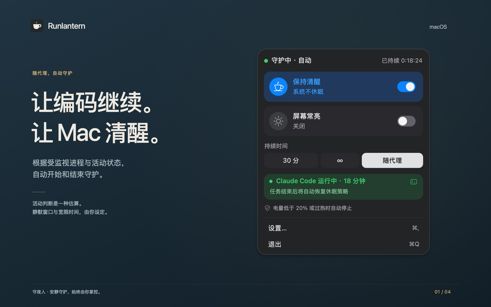
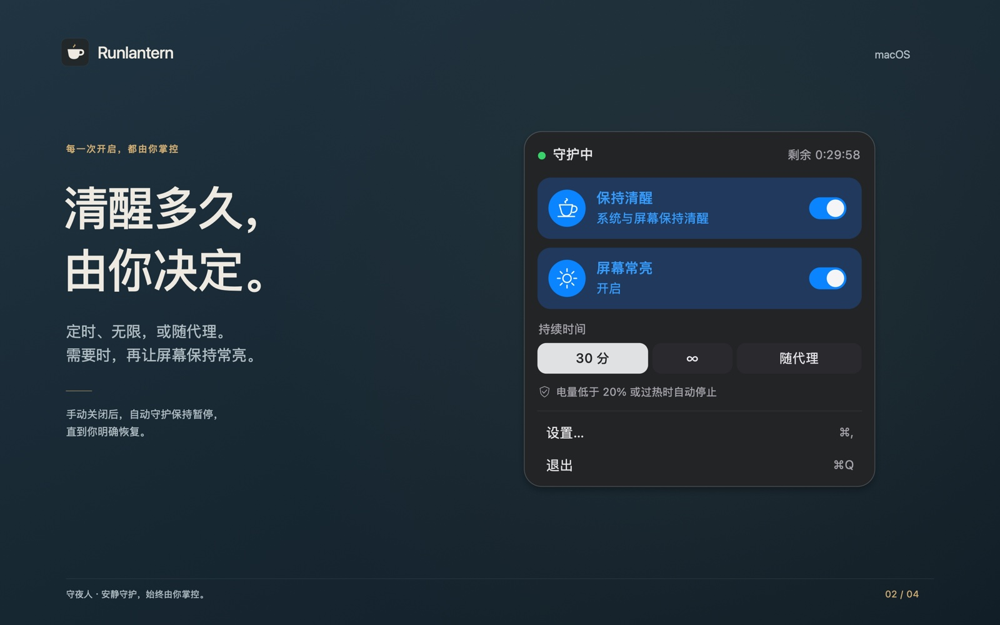
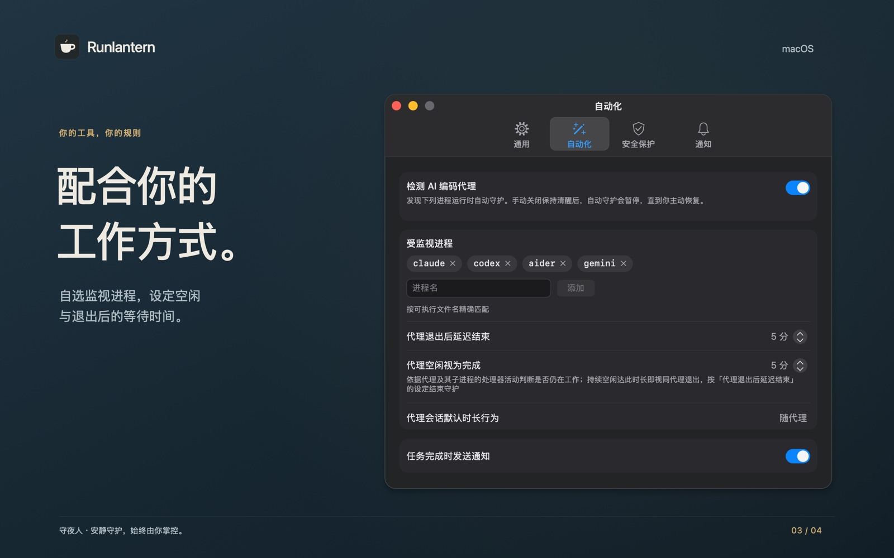
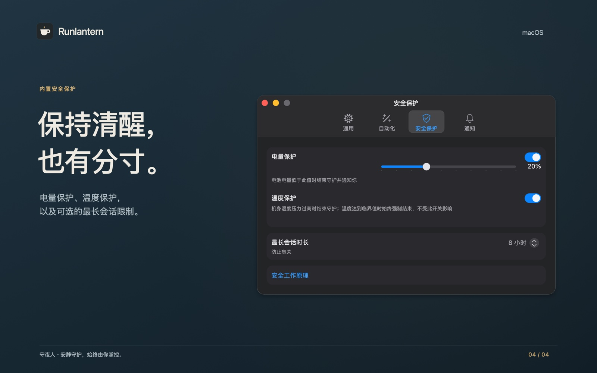

  <picture>
    <source media="(prefers-color-scheme: dark)" srcset="assets/icon-dark.png">
    
  </picture>

<h1 align="center">守夜人 Runlantern</h1>

  <strong>AI 编码代理工作时，让 Mac 保持清醒。</strong> 
  一款免费的菜单栏工具：Claude Code、Codex、Aider、Gemini CLI 忙着的时候阻止 Mac 空闲休眠，干完活就退到一边。

  

  
  
  
  

  <a href="README.md">English</a> ·
  <a href="https://runlantern.pages.dev/">官网</a> ·
  <a href="https://runlantern.pages.dev/privacy/">隐私说明</a>

  

## 能做什么

- **代理干活时自动守护。** 选择“随代理”，受监视的命令行工具一开始忙，守夜人就开始守护；工具退出或安静下来，过完你设定的宽限时间就结束。
- **也可以自己决定。** 自定义倒计时、无限时长，以及可选的“屏幕常亮”。
- **说关就关。** 关闭守护后，所有自动开始都会暂停，重启应用依然有效，直到你重新打开。
- **安全保护。** 电量阈值、温度保护和最长会话时长；系统温度压力达到临界时一定结束守护。
- **状态如实显示。** 如果系统没有确认电源请求或释放成功，面板会直接告诉你，不显示假状态。
- **只在你的 Mac 上工作。** 无需账号，不联网，不做统计；App Store 隐私标签为“未收集数据”。

<strong>更多图片</strong>

 

## 工作原理

- **识别代理。** 按可执行文件名匹配受监视的工具；通过 `node`、Python 启动的工具，按它运行的脚本识别。
- **判断在忙。** 工具的进程树 CPU 占用超过 1% 就算在忙；安静超过静默窗口、再过完宽限时间后结束守护。
- **保持清醒。** 只用一条公开的 IOKit 电源断言 `PreventUserIdleSystemSleep`，开启“屏幕常亮”时再加 `PreventUserIdleDisplaySleep`。在 `pmset -g assertions` 里看得到，会话结束即释放。
- **不碰的东西。** 合上盖子或主动选择“睡眠”时仍按 macOS 的行为；不修改你的电源设置。

使用 SwiftUI 与 AppKit 开发；启用 App 沙盒，通用二进制，1.6 MB。

## 系统要求

macOS 15 或更高版本，Apple 芯片或 Intel 处理器。

## 支持

先看[官网的常见问题](https://runlantern.pages.dev/#questions)，或发邮件到 **ac_block@outlook.com**，写明应用版本、macOS 版本和出问题前的操作。

---

这个仓库是项目主页，不包含源代码。图片是按应用界面绘制的展示图，图中的时间均为示例。守夜人与 Anthropic、OpenAI、Google 及 Aider 的开发者没有隶属关系。
